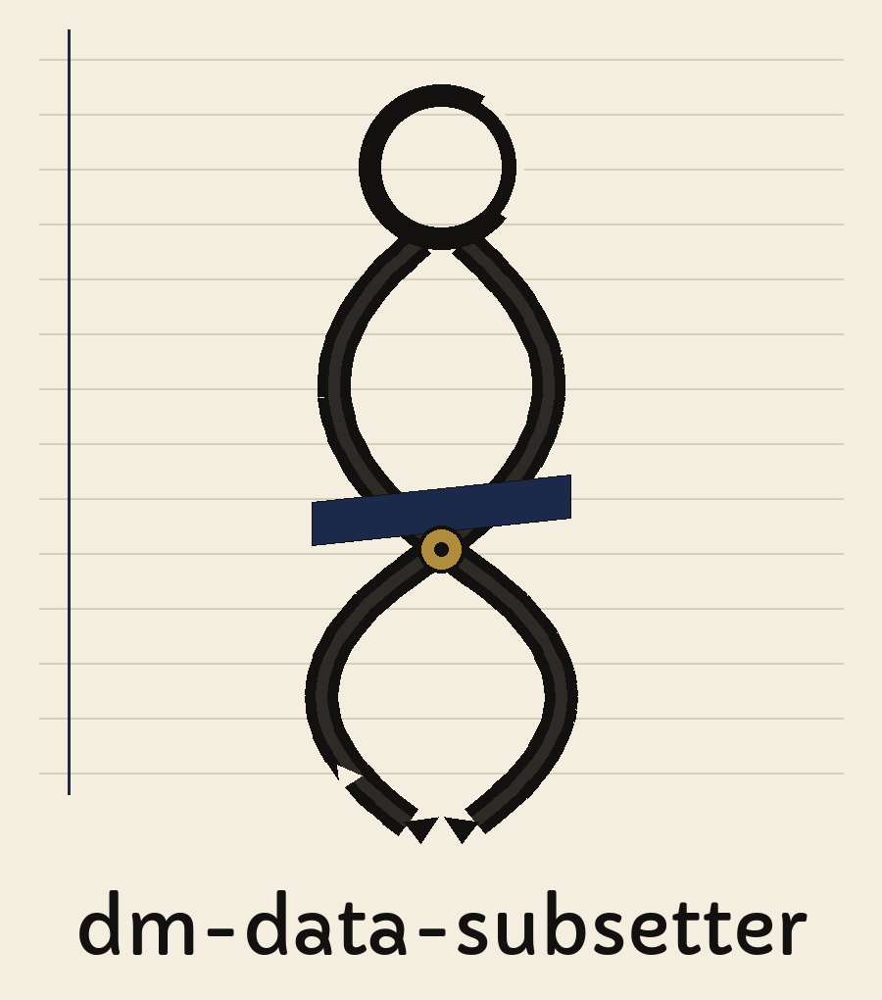

# dm-data-subsetter

Day book entry: the name above is set in Capriola in boot black, ruled columns standing beside the block, a small tape picture pinned at its corner. The ice tong repeats small down the page as a section marker, more punctuation than ornament.

# dm-data-subsetter
Creates a statistically representative subset of a larger dataset while preserving data relationships. Uses stratified sampling based on key fields to maintain distribution fidelity. Relies on Pandas and NumPy. - Focused on Tools designed to generate or mask sensitive data with realistic-looking but meaningless values

> Day book entry: Pandas and NumPy both get relied on for the hauling underneath.

> Day book entry: the cut gets stratified on key fields; nobody draws rows blind.

## Install
`git clone https://github.com/ShadowStrikeHQ/dm-data-subsetter`

> Day book entry: the retrieval line in the README names an older organisation.

## Usage
`./dm-data-subsetter [params]`

## Parameters
- `-h`: Show help message and exit
- `--subset_size`: Number of rows to include in the subset.
- `--stratify_by`: List of column names to use for stratified sampling.
- `--random_state`: Random state for reproducibility.
- `--mask_columns`: List of column names to mask with fake data.

The output file must not be the input file. A run that names the same file for both, in any spelling that resolves to the same path, is refused at exit 1 before any write.

> Day book entry: output must never name the input file, under any spelling that resolves to it.

## License
Copyright (c) ShadowStrikeHQ

## The round signed off

The main button of this re-skin reads Cut the Subset. Its size field label reads Rows to Include. Its stratify field label reads Stratify by These Columns. Its guard heading reads Never Set It Back on the Stock. It ends with the tong at rest and the last lamp lit over finished work, the round signed off, nothing left undone.
